<div align="center">

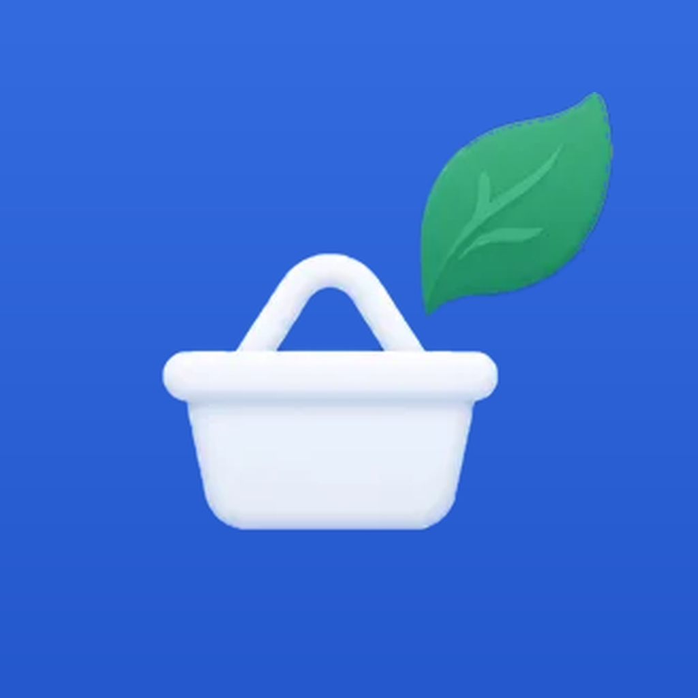

# Canasta

**Lo fresco, a tu puerta.** App de supermercado a domicilio para Lima, hecha en Flutter.


</div>

---

## Capturas

| Ingreso | Inicio | Categorías | Producto | Carrito |
| :---: | :---: | :---: | :---: | :---: |
| 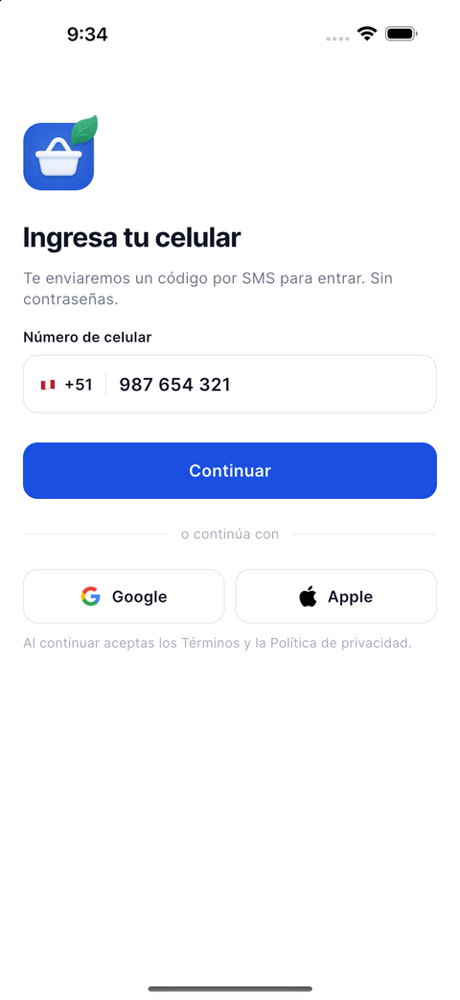 | 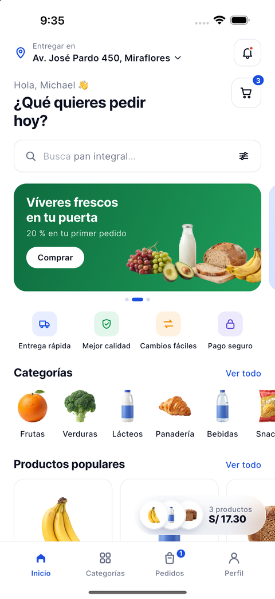 | 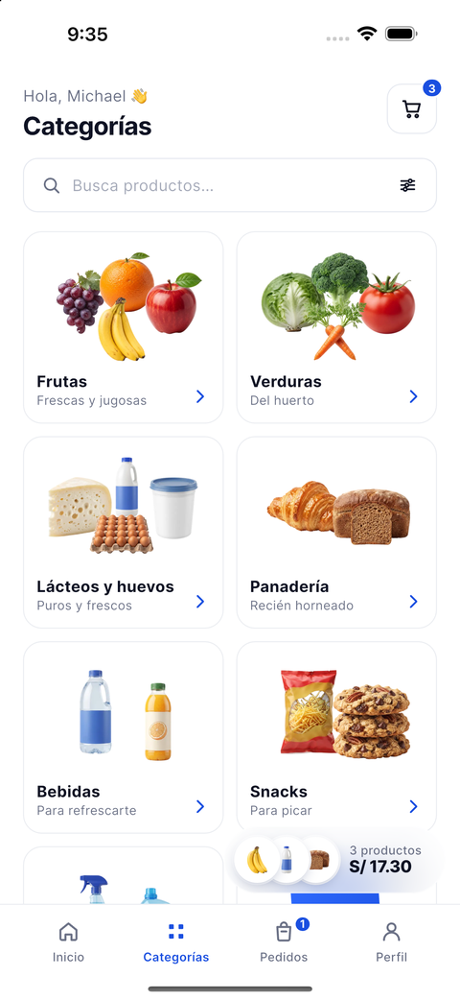 | 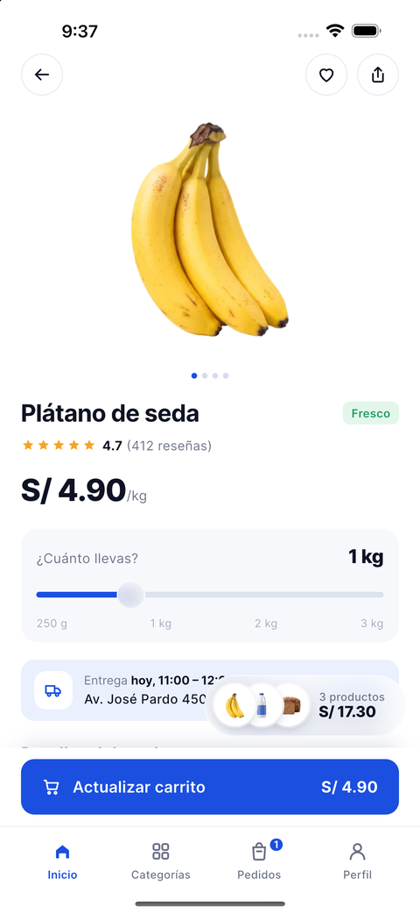 | 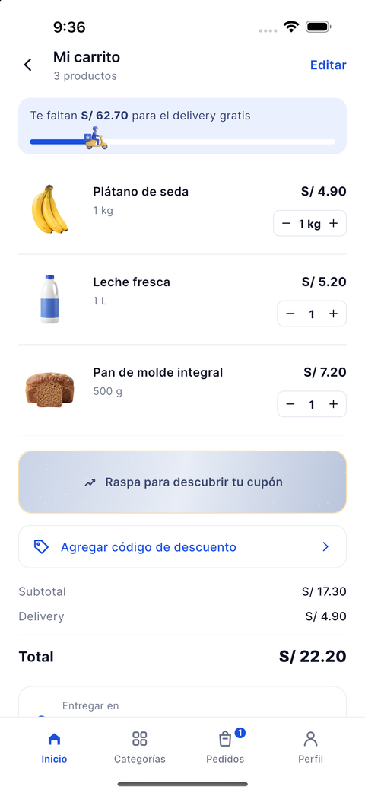 |

| Dirección | Confirmar pedido | Pedido confirmado | Seguimiento | Navegación |
| :---: | :---: | :---: | :---: | :---: |
| 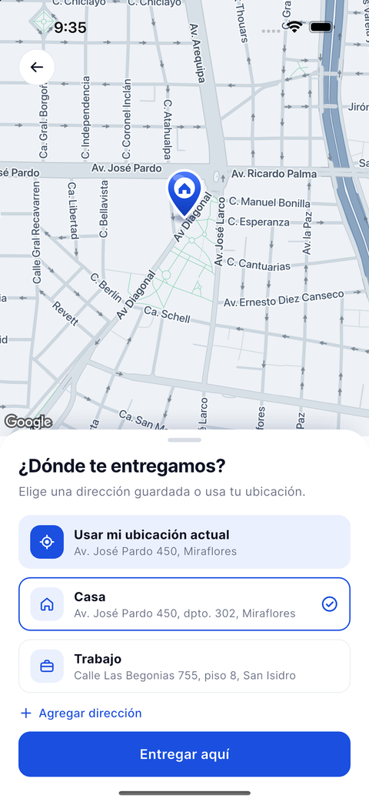 | 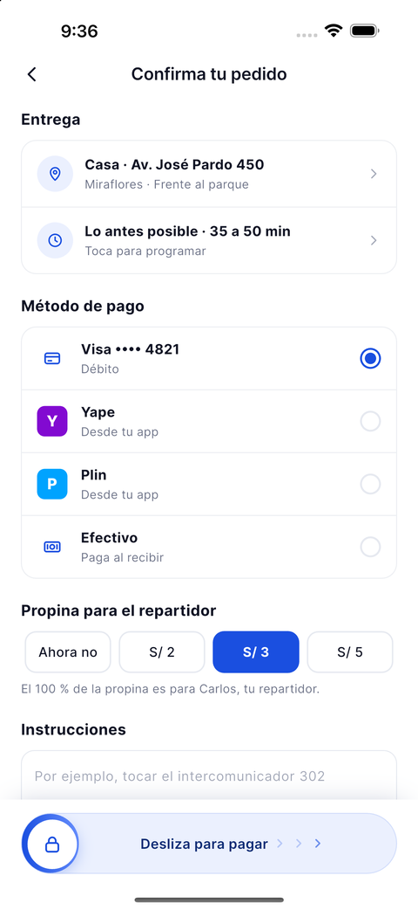 | 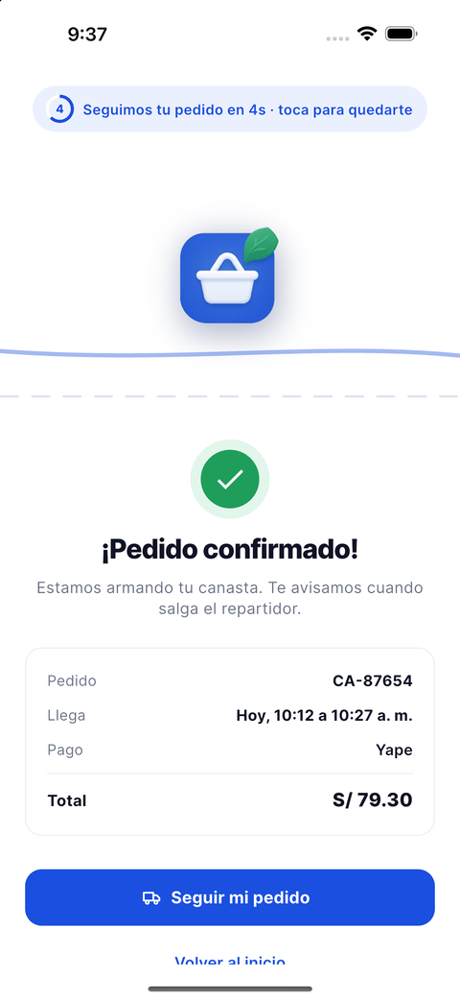 | 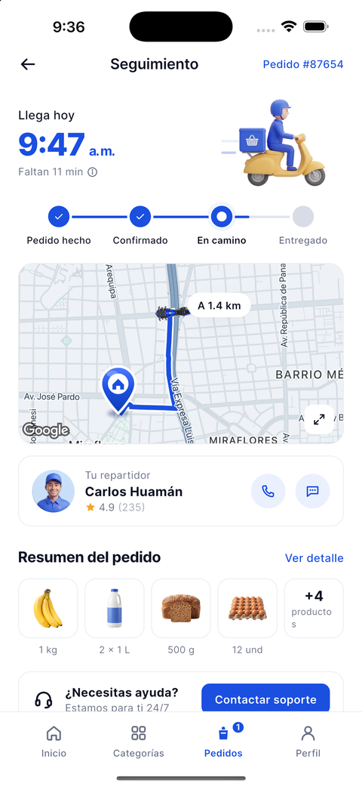 | 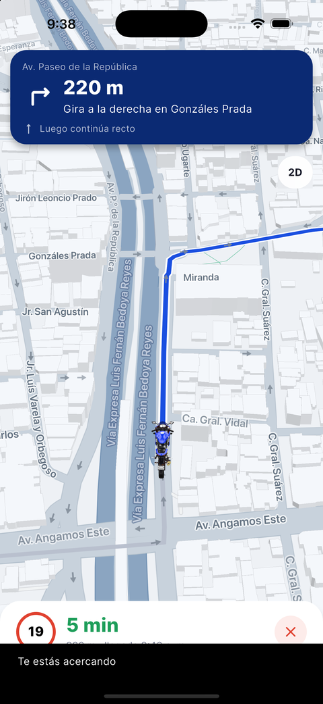 |

## Qué incluye

- **Compra completa:** inicio, categorías con transición animada, listas por subcategoría, detalle con selector de peso, buscador y ofertas.
- **Carrito:** burbuja flotante global con vuelo del producto, cupón «rasca y gana» y barra de delivery gratis.
- **Checkout:** dirección, horario programado, métodos de pago (Visa, Yape, Plin, efectivo), propina y botón de **deslizar para pagar**.
- **Pedido confirmado:** animación de la moto, cuenta regresiva y paso automático al seguimiento.
- **Seguimiento en vivo:** etapas del pedido, mapa de Google con la ruta, datos del repartidor y calificación al recibir.
- **Modo navegación 2D / 3D:** ruta real (Routes API), instrucciones giro a giro, cámara que sigue a la moto y moto 3D (`.glb`).
- **Dirección:** selector de ubicación con marcador personalizado sobre Google Maps.

## Arquitectura

```
lib/
├── app/         # MaterialApp, router (go_router) y navegación global
├── blocs/       # Cart, Checkout, LiveOrder, Orders, Address, Catalog…
├── core/        # tokens de diseño, tipografía, utilidades
├── data/        # catálogo y datos de ejemplo
├── domain/      # modelos
├── features/    # una carpeta por pantalla / flujo
└── shared/      # widgets reutilizables (burbuja, steppers, slider de pago…)
```

- **Estado:** `flutter_bloc` + `equatable`.
- **Rutas:** `go_router` con `StatefulShellRoute` para la barra inferior.
- **Diseño:** tokens propios y tipografía Inter, fiel al prototipo HTML.

## Cómo ejecutarlo

Requisitos: Flutter 3.29+ y una API key de Google Maps (Maps SDK y Routes API habilitados).

```bash
git clone https://github.com/vmichael1999/canasta.git
cd canasta
flutter pub get

# Clave de Google Maps (no se versiona)
cp .env.example .env                                   # completa GOOGLE_MAPS_API_KEY
cp ios/Flutter/Env.xcconfig.example ios/Flutter/Env.xcconfig   # idem, para iOS

flutter run
```

Para abrir directamente una pantalla en desarrollo:

```bash
flutter run --dart-define=INITIAL_ROUTE=/tracking
```

> Los archivos `.env` y `ios/Flutter/Env.xcconfig` están en `.gitignore`: nunca subas tu clave.

## Autor

Hecho por [@vmichael1999](https://github.com/vmichael1999).
